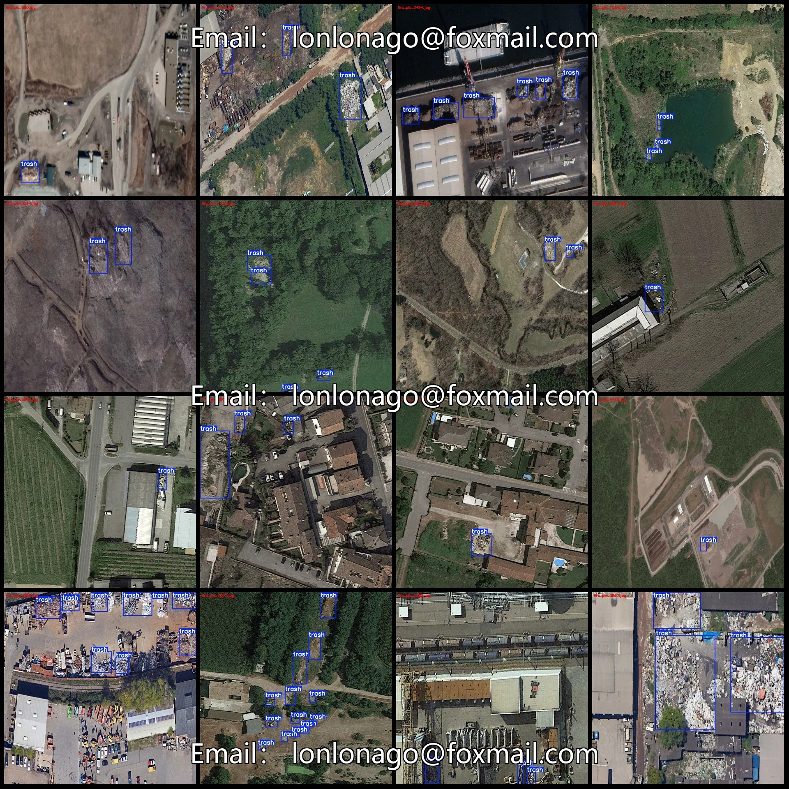
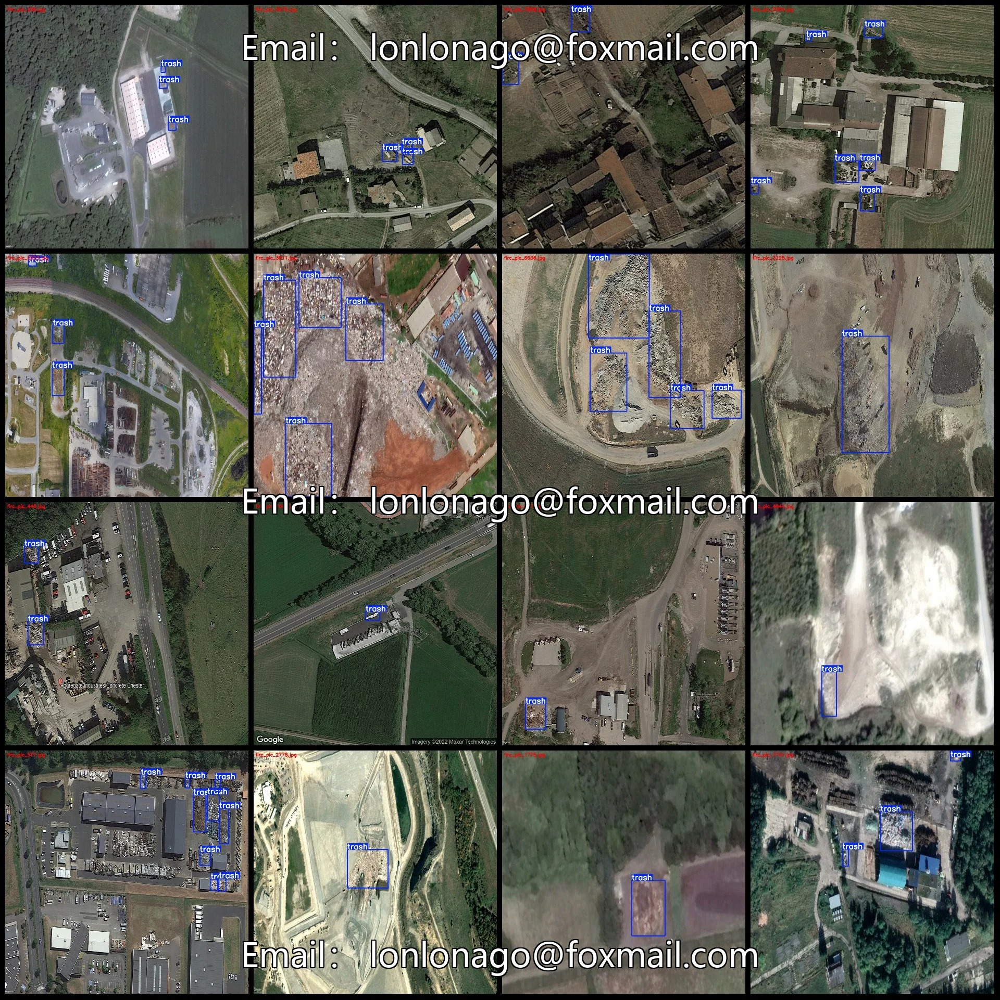
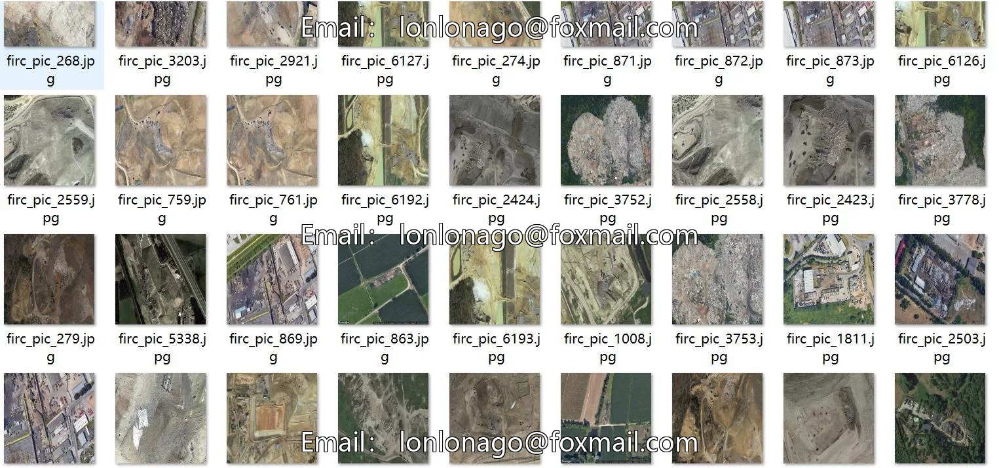
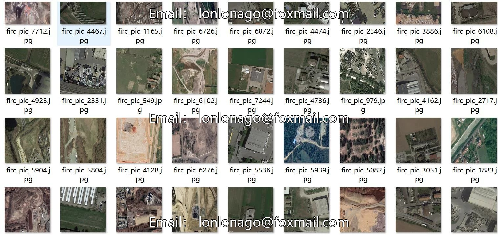

# Drone-view aerial photography dataset for garbage detection in VOC+YOLO format with 8140 images.

## Body

Drone-Viewpoint Aerial Photography Dataset for Trash Detection: VOC+YOLO Format with 8140 Images in 1 Category

Warm Reminder: Due to the dataset's replicability, please confirm compliance before purchasing.

Dataset Format: Pascal VOC format + YOLO format (excluding split paths in txt files, only including jpg images and corresponding VOC format xml files and yolo format txt files)
Number of Images (JPG File Count): 8140
Number of Annotations (XML File Count): 8140
Number of Annotations (TXT File Count): 8140
Number of Annotation Categories: 1
Annotation Category Name: ["trash"]
Number of Boxes per Category
Trash Boxes = 33799

Total number of frames: 33,799
Number of images per category
Trash category has 8,140 images
Image resolution: 1280x1280
Labeling tool used: labelImg
Labeling rules: Draw a rectangle around the category.
Important note: The dataset does not have separate training, validation, and test sets; you need to partition them yourself.
Special statement: This dataset does not guarantee the accuracy of the trained models or weight files.

## Images

## Payment

Here is a pay link on Stripe ( https://buy.stripe.com/3cs8yP7sY87d0vu9AB ). Please contact me lonlonago@foxmail.com after funding $89, and I will send you a complete data files , thank you!

